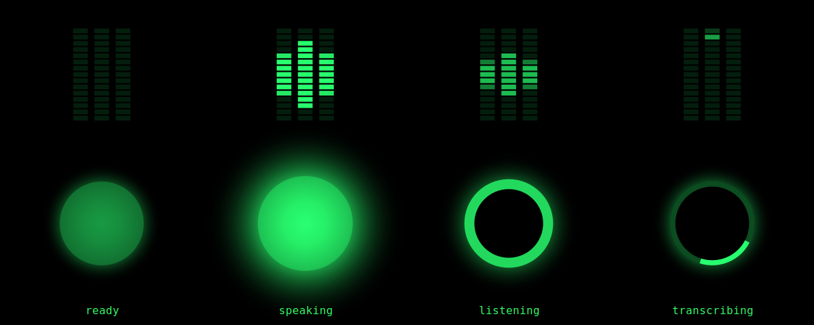
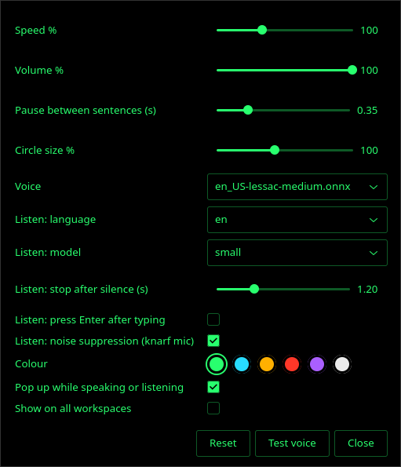
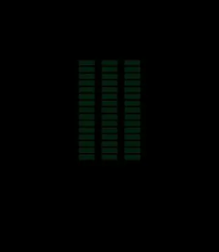
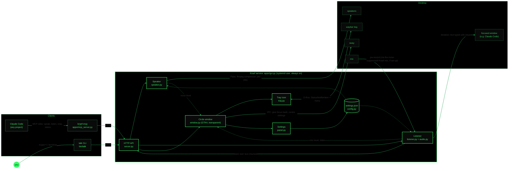
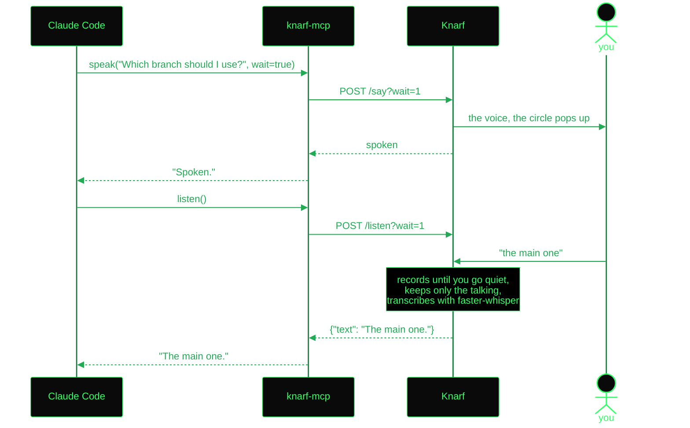

# Knarf

A little window that talks: three columns of green lights that grow with the voice (or, in the settings, a single
green circle that glows with it). The window is transparent and borderless, so only the green shows.

Silent preview. With sound: [docs/demo.mp4](docs/demo.mp4) (made from the real voice and drawing code by
`just demo`).

    just install        # deps, voice, `knarf` + `talk` in ~/.local/bin, launcher, and the systemd user service
    just sway-bind      # optional: Super+\ = push-to-talk in sway
    just logs           # follow the service log (just restart after code changes)
    talk "Hello there"  # make it speak (also: echo hi | talk, talk -w, talk --stop, talk --status)
    talk --toggle       # show or hide the window (talk --quit quits Knarf)
    talk --chat         # talk with Claude directly, until you say you're done (run again to stop)

In the window: click to listen, middle-click stops speaking, right-click or S opens settings, Esc stops speaking,
Ctrl+Q quits.

## Architecture

Knarf is one always-running process (a systemd user service) that owns the speaker, the mic, the circle and the
tray icon. Everything else talks to it over a small HTTP API on `127.0.0.1:47820`: Claude Code through the MCP
server, you through `talk` (a key binding, the terminal) or the tray icon. Mostly Knarf is an extension to Claude
Code: it speaks and listens for Claude. The one exception is the standalone mode (below), where Knarf asks Claude
itself.

Inside the process: the GTK main loop runs the circle, tray and settings window; the speaker, each listening
session and the HTTP server run on their own threads. They meet in a few thread-safe places: the speaker's queue,
the listener's state, and the commands and events in `server.py` that the GTK loop polls every 50 ms. The circle is
hidden most of the time: it pops up while Knarf speaks or listens and hides again after, handing keyboard focus
back to the window you were in (so dictation still types there).

How Claude asks you something out loud:

Dictation is the same listening, started by you (Super+\, a middle-click on the tray icon, or a click on the
window); the text is typed into the focused window instead of being returned.

Listening (speech to text): press the global shortcut (`talk --listen`, bound to Super+\ in sway), or click the
window / press Space in it. The lights follow your voice while it listens (the circle turns into a ring), stops when you go quiet,
transcribes locally with faster-whisper and types the text into the focused window with `wtype`. If you started
it by clicking the window, the text is typed once you switch to another window. Run it again to stop early.

Settings: right-click the window or press `S`.
Speed, volume, pause between sentences, voice (any `.onnx` in `~/.local/share/piper`), colour,
style (bars or circle), size, position (centre, top, bottom or a corner), how long the spoken sentence stays
under it, show on all workspaces (sway sticky), and for listening: language (default English), Whisper model, silence timeout and
whether to press Enter after typing. Changes apply immediately and are saved to `~/.config/knarf/settings.json`.
Requires Piper in `~/.local/share/piper` (its venv provides numpy, piper-tts and faster-whisper), `pw-play`, `pw-record`, `ffmpeg`,
`wtype`, and GTK4 Python bindings from apt (python3-gi, python3-gi-cairo, gir1.2-gtk-4.0), which Knarf
borrows from the system Python since PyGObject doesn't build in the venv without dev headers.
Anything personal Claude should know when talking with you (an accent, names) goes in
`~/.config/knarf/instructions.md`, outside the repo; the MCP server adds it to its instructions.
Environment: `KNARF_SPEED` (Piper length scale at 100% speed, default 1.3), `KNARF_PORT` (default 47820), `KNARF_MODEL`.

`just uninstall` removes the commands, launcher and sway binding (Piper, models and settings are kept).

Always running: `just service` installs a systemd user service (`~/.config/systemd/user/knarf.service`), so Knarf
starts with your session and restarts if it crashes; nothing is added to the sway config. It lives in waybar's tray
like other background apps: left-click shows/hides the window, middle-click listens, right-click opens a menu (show/hide,
listen, stop speaking, settings, restart, quit). The tray icon follows the style (three bars or a dot): green, bigger while
speaking, red while listening, yellow while transcribing. The window is hidden by default and pops up while Knarf speaks or listens
(setting "Pop up while speaking or listening"), without taking keyboard focus. Quitting from the tray stops it until
the next login (or `systemctl --user start knarf`).

Code: the `knarf/` package (config, audio, speaker, listener, server, gtk, wm, style, tray, window, panel) and the
program in `apps/gui.py`, started by `bin/knarf`. `knarf/wm/` is what Knarf asks of the window manager on Wayland
(where an app can't place its own windows, keep them out of the focus or show them on every workspace): the
`WindowManager` interface in `base.py`, with `sway.py` (through `swaymsg`) and `none.py` (does nothing, for other
desktops); `detect()` picks one. Another window manager is one more subclass.

## For Claude Code (MCP)

`just mcp` registers Knarf's MCP server (`bin/knarf-mcp`, `apps/mcp_server.py`, standard library only) for all
projects. Claude then has `speak` (text, wait), `listen` (returns what you said), `stop` and `status`; it starts
Knarf if it isn't running.

[`examples/claude-code/`](examples/claude-code/) has an example on top of that: a `/knarf` skill to work with
Claude by voice until you say you're done, and a hook that shows the voice traffic in the terminal.
`just claude-example` installs them.

## Talking with Claude directly (standalone mode)

Without a terminal: pick "Talk to Claude" in the tray menu, or run `talk --chat`. Knarf says hi and listens, sends
what you said to Claude Code (`claude -p` in your home folder, on your claude.ai login: no API key), and speaks the
answer a sentence at a time as it streams in. Then it listens again, in the same conversation, until you say you're
done ("I'm done", "I'm finished", "that's all", "bye"), you stop it the same way you started it, or nobody has said
anything for about two minutes. While Claude thinks, the window shows the transcribing state.

It's Claude only: no tools and no MCP servers, so it answers from what it knows (it can't look things up, read your
files or change anything). Claude runs without a terminal here, so nobody could approve a tool anyway.
The menu item only shows when `claude` is installed (on the PATH or in `~/.local/bin`).
Ported from hektor's brain: `knarf/chat.py`.

## Listening, in detail

Ported from [hektor](https://github.com/dellambrogio/hektor): a 100 ms chunk counts as talking only when it's loud (over the room's noise x 2.5, measured
in the first 0.3 s) and voiced (it has a pitch, which fans, hiss, key clicks and thumps don't), and you're talking
when 3 of the last 5 chunks are. The recording ends after the silence setting without talking, measured against
your own speech level. Only the talking, with 0.3 s either side, goes to Whisper (it makes up words in silence),
and its noise tags like `[BLANK_AUDIO]` are dropped. The mic is picked like hektor does (a USB mic first; never
Bluetooth earbuds in music mode, which record silence), with a 300 Hz high-pass filter. Tuning constants are in
`knarf/config.py`; the journal (`just logs`) has each recording's length, noise and threshold.

`just audio-setup` adds PipeWire's WebRTC noise suppression as a "Knarf mic" (it restarts PipeWire, so audio stops
for a moment); Knarf records through it when it's there and the setting is on. `just audio-remove` takes it out.

The voice: the next sentence is made while one plays, it's evened out with a compressor and its peaks brought to
the volume setting, and markdown, links and URLs are never read out.

## License

MIT, see [LICENSE](LICENSE).
